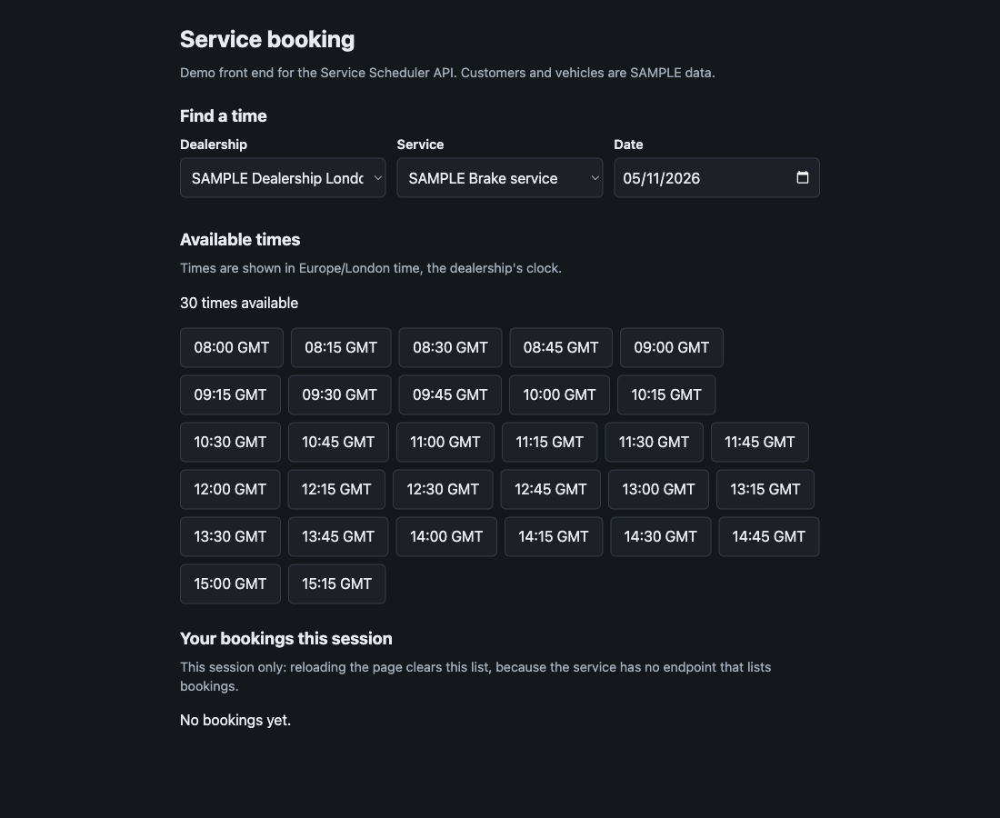
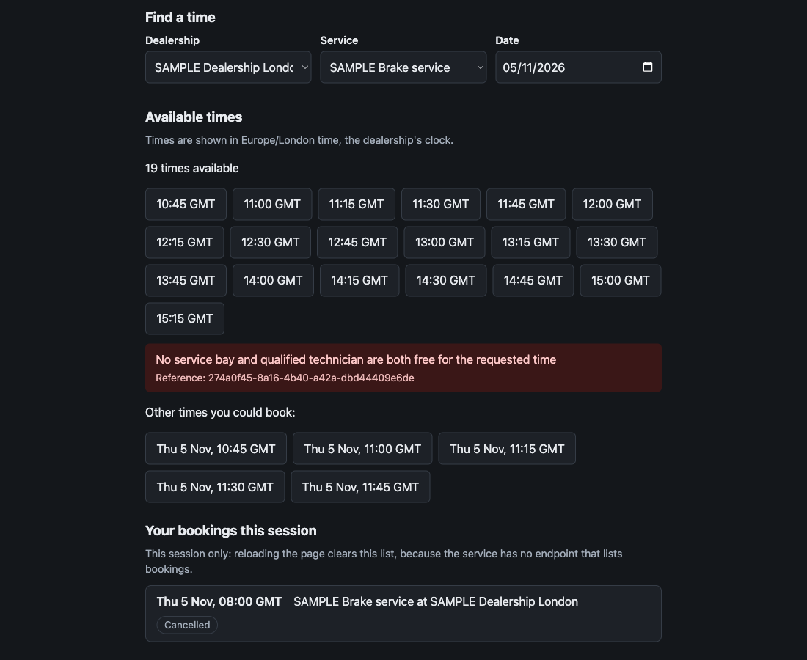
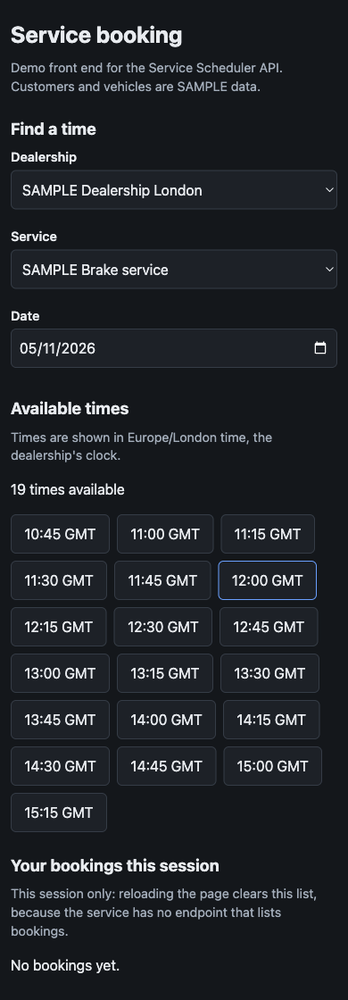

# Keyloop Service Scheduler

Keyloop technical assessment, **Scenario A: The Unified Service Scheduler**. A backend that books a
service appointment only when **a service bay and a qualified technician are both free for the whole
service duration**, and stores an appointment linking customer, vehicle, technician and bay.

- **Layers implemented:** the backend in depth (REST API, PostgreSQL, OpenAPI contract), plus a small
  [booking UI](frontend/README.md). cURL examples are in `docs/examples.sh`.
- **Stack:** Node.js 24, TypeScript (strict), Fastify, Zod, Kysely, PostgreSQL 16, Vitest, Testcontainers.
- **Documents:** [System Design Document](docs/system-design.md) ·
  [API contract](specs/001-service-scheduler/contracts/openapi.yaml) ·
  [Spec trail](specs/001-service-scheduler/) · [AI log](AI_LOG.md) · [Video script](docs/video-script.md)

## What it does

|                        | Endpoint                                                                  | Notes                                                                                                                                                                                             |
| ---------------------- | ------------------------------------------------------------------------- | ------------------------------------------------------------------------------------------------------------------------------------------------------------------------------------------------- |
| Book                   | `POST /appointments`                                                      | The **system** assigns bay and technician. Needs an `Idempotency-Key` header. `201` created, `200` replay, `409` no capacity (with up to 5 alternative slots), `422` business rule, `404`, `400`. |
| Availability           | `GET /availability?dealershipId&serviceTypeId&date`                       | Every bookable 15-minute start on that local date. Uses the same rules as booking.                                                                                                                |
| Read                   | `GET /appointments/{id}`                                                  | Includes cancelled ones.                                                                                                                                                                          |
| Cancel                 | `POST /appointments/{id}/cancel`                                          | Idempotent. The record is kept and the place is freed.                                                                                                                                            |
| Block                  | `POST /bays/{id}/unavailability`, `POST /technicians/{id}/unavailability` | Maintenance, leave, off shift. Refused if it would overlap a confirmed appointment (`409`) or another block (`409`).                                                                              |
| List and remove blocks | `GET` the same URLs; `DELETE .../unavailability/{blockId}`                | Earliest first; `204` on removal; a block cannot be removed through the wrong resource or kind.                                                                                                   |
| Reference              | `GET /dealerships`, `GET /service-types`                                  |                                                                                                                                                                                                   |
| Operations             | `GET /health`, `GET /ready`, `GET /metrics`                               | Liveness, readiness (checks the database), Prometheus.                                                                                                                                            |

## Build, run and test

**Prerequisites:** Node.js 24 (see `.nvmrc`), Docker running (the database, and the integration tests
start real PostgreSQL containers), `curl` and `jq` for the examples.

```bash
npm install
cp .env.example .env              # SAMPLE local settings, no real secrets
docker compose up -d db           # PostgreSQL 16
npm run migrate                   # schema and constraints
npm run seed                      # SAMPLE data only (safe to run again)
npm run dev                       # http://localhost:3000
```

Try it (needs the server running):

```bash
bash docs/examples.sh             # every scenario with real requests; safe to re-run
curl -s localhost:3000/health
```

Run the tests:

```bash
npm test                          # everything: unit + integration + contract (about 1 minute)
npm run test:unit                 # fast, no Docker
npm run test:concurrency          # the race tests; CONCURRENCY_ROUNDS=60 for a stress run
npm run typecheck && npm run lint && npm run lint:api   # types, code style, OpenAPI contract
npm run build && npm start        # the compiled server
```

All data in the repository is marked `SAMPLE`. Configuration is read from the environment and
validated at start-up; errors name the variable but never print its value.

## How it stays correct

Double-booking is prevented in the database, not just in code. Four layers, each tested (details in
[`docs/system-design.md`](docs/system-design.md#5-correctness-under-concurrency-the-core-design-decision)):

1. **Exclusion constraints** on bay and technician time ranges (half-open, so back-to-back is fine).
2. **Row locks** (`FOR NO KEY UPDATE SKIP LOCKED`): bookings never wait on each other, so no deadlocks.
3. **Re-check under the lock**, covering blocks that commit in between.
4. **Retry policy**: contention is retried until capacity is gone or a 1 second budget ends.

Retries are safe because every booking carries an idempotency key. Working hours, the 15-minute
grid and "which day" are computed in the **dealership's time zone**, including daylight saving.

## Booking UI

A deliberately simple React front end in [`frontend/`](frontend/README.md): choose a dealership, service
and date, see the times in the **dealership's own clock**, book, recover from a conflict, cancel.

```bash
cd frontend && npm install && npm run dev      # http://localhost:5173 (backend must be running)
npm run test:ui                                # 61 tests, from the repository root
```

| Times and booking                  | After a conflict                         | On a phone                         |
| ---------------------------------- | ---------------------------------------- | ---------------------------------- |
|  |  |  |

Its limits are stated on screen: customers are a SAMPLE-data demo picker (the API has no
customer-listing endpoint, on purpose) and the list of bookings covers the current session only.

## Project layout

```text
src/domain/        pure rules: time ranges, working hours, slots, resource ranking (no I/O)
src/services/      use cases and transaction boundaries (booking, availability, cancel, blocks)
src/db/            migrations, typed queries, SAMPLE seed
src/api/           routes, validation, the single error shape
src/observability/ request IDs, PII-safe logs, metrics, spans
tests/             unit, integration (real PostgreSQL), contract (OpenAPI), performance
specs/             constitution, spec, clarifications, plan, research, data model, contract, tasks
frontend/          the booking UI (React, Vite), with its own tests and README
docs/              system design, cURL examples, video script
```

## Results

- **Tests:** 522 passing: 461 backend (197 unit, the rest integration, contract, concurrency and
  performance) and 61 frontend.
- **Performance** at 50 concurrent requests on a laptop, against targets set in the plan: booking
  p95 **125 ms** (target 300 ms); availability p95 **31 ms** (target 200 ms).
- **Concurrency:** 20 parallel requests for the last slot give exactly one booking; 30 requests for
  6 places give exactly 6. The suite was run 20 times in a row after the final fix (20 of 20 clean).

## Assumptions and limitations

Assumptions (all in the spec): the system assigns bay and technician; the buffer is per service type
and added to the duration; bays and technicians can be blocked; slots start on 15-minute boundaries;
the whole occupied period must fit inside one day's working hours; cancelling is allowed at any time.

Limitations, stated plainly: no authentication or rate limiting; no dealership holidays; a block over
an existing appointment is refused rather than cancelling it; alternatives are the _earliest_ free slots,
not the nearest to the requested time; tracing is manual
spans only (automatic HTTP and database spans need an ESM loader hook, see the design document).

## AI Collaboration Narrative

<!-- DRAFT: the facts below come from AI_LOG.md and the commit history. Put it in your own words
before submitting, and keep only what you can speak to in the interview. -->

I used Claude Code throughout, and treated it as a fast collaborator whose output is a draft until I
have seen it fail and pass.

### Strategy: I decide, the AI drafts, tests judge

- **Spec first.** I followed spec-driven development with GitHub Spec Kit: constitution, spec, clarify,
  plan, tasks, analyze, then code. Tests were written and watched failing before the code they test,
  and the history shows it (a failing-test commit, then the commit that makes it pass). The exceptions
  are in the log: for example the booking-metrics tests were written after the code, so they were
  validated afterwards by deliberately breaking the code.
- **My decisions, not the AI's.** I chose the scenario, backend first, the stack, and I answered the
  clarifying questions. On one I **overrode the AI's recommendation**: it suggested keeping resource
  availability simple, and I chose per-resource unavailability, accepting the extra schema and tests. I
  also set the rule for alternative slots (up to 5, the requested day first, then the next 7 days) and
  chose to start a clean repository rather than continue an older half-built one.
- **Small slices.** One task or small group at a time, reviewed as a diff, committed separately.

### Verification: nothing counts until I have watched it fail

- **Run the claims.** The data-model SQL was run on a real PostgreSQL before any code existed
  (10 scenarios and a 20-way parallel insert race). The contract is linted. A hands-on run of the
  compiled service with cURL is part of the process, not an afterthought.
- **Break the logic.** After each feature I had the code deliberately broken (about 80 mutations) to
  prove the tests can fail. Where a break passed, either it was masked by another safety layer
  (recorded honestly) or my test was too weak (and I fixed the test).
- **Deterministic races.** Rare interleavings are reproduced with small test seams, because a race
  test that "sometimes fails" proves little. Flakiness was checked by running the concurrency suite
  20 times in a row.
- **Cross-check the whole.** `/speckit-analyze` found 14 inconsistencies before any implementation,
  including a success criterion that contradicted a planned test.

### Mistakes caught (the useful part)

| What went wrong                                                                                                       | How it was caught                                                      | Outcome                                                                                         |
| --------------------------------------------------------------------------------------------------------------------- | ---------------------------------------------------------------------- | ----------------------------------------------------------------------------------------------- |
| The AI's own test harness was wrong three times (a bad UUID, a failed `sed`, a truncated file), giving false failures | Results did not match the SQL being tested                             | Reran against the document's SQL extracted verbatim                                             |
| The AI wrote a code comment claiming Node's JSON errors quote the request body                                        | A deliberate break survived; a direct probe showed the claim was false | Comment and test corrected; behaviour kept as defence in depth                                  |
| `FOR UPDATE` row locks made a test deadlock                                                                           | A hung test run                                                        | Diagnosed as a conflict with foreign-key locks; now `FOR NO KEY UPDATE`, with a regression test |
| A request with the same idempotency key could get a false 409                                                         | Predicted from the code, then reproduced deterministically with a seam | Re-read the key before ever answering 409                                                       |
| One run in 20 gave a false "no capacity" (5 confirmed, 25 rejected, a place free)                                     | The 20-run flakiness loop                                              | Fixed retry count replaced by a time budget; 20 of 20 clean afterwards                          |
| Cancelling returned 400 from real clients                                                                             | The hands-on cURL run (every integration test missed it)               | Empty JSON bodies accepted, JSON parser left untouched                                          |
| Ordinary 409s were recorded as span errors; automatic tracing produced nothing                                        | Reading what the running server actually emitted                       | Expected rejections no longer errors; dead instrumentation removed and documented               |
| Tests blocked a resource nobody would have chosen, so a bug survived                                                  | Mutation survived                                                      | Tests now block the resource that would be picked first                                         |

### Quality

522 tests, strict TypeScript, ESLint, Prettier, a linted OpenAPI contract, measured performance, and a
log (`AI_LOG.md`) of every meaningful interaction, including what the AI got wrong. The places I am
less sure of are listed under limitations.
