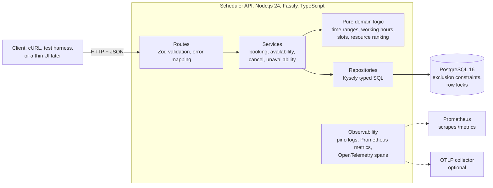
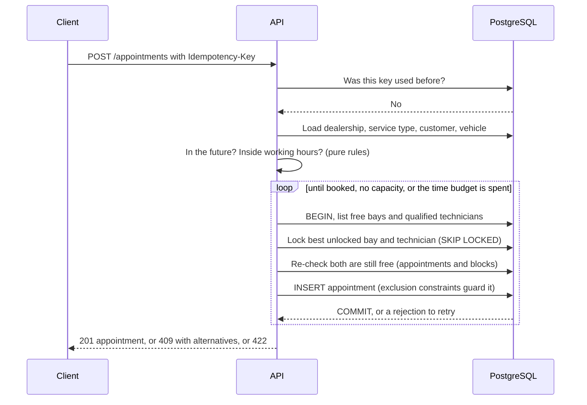
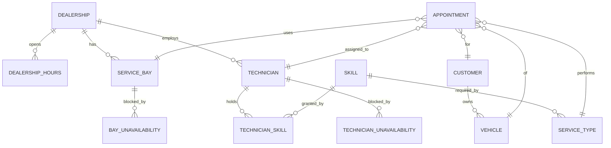

# System Design Document: Unified Service Scheduler

Keyloop technical assessment, **Scenario A: The Unified Service Scheduler** (Domain: Ownership).

This document describes what was built. Where the implementation changed the original plan, it
says so and says why. The working specification trail (spec, clarifications, plan, tasks) is in
[`specs/001-service-scheduler/`](../specs/001-service-scheduler/).

## 1. Problem and scope

A customer, or a service adviser acting for them, asks for a service appointment for a vehicle,
a service type and a dealership at a desired time. The system confirms it only if **both a service
bay and a qualified technician are free for the whole service duration**, and then stores an
appointment linking customer, vehicle, technician and bay.

**Implemented (backend):** booking, availability, alternative slots on conflict, cancel, blocking a
bay or technician, safe retries (idempotency), a REST API with an OpenAPI contract, observability.
A small React booking UI (section 10) shows the API working end to end.

**Not implemented (documented, deliberate):** authentication and authorisation, payments,
notifications, dealership holidays, cross-dealership assignment, rescheduling as a single
operation (cancel plus rebook), automatic cancellation when a block is added over an appointment,
and customer search in the UI (the API has no such endpoint, on purpose).

### Assumptions made where the brief was ambiguous

| Ambiguity                             | Assumption (all confirmed by the owner in the clarify step or review)                                                                                                               |
| ------------------------------------- | ----------------------------------------------------------------------------------------------------------------------------------------------------------------------------------- |
| Who picks the bay and technician?     | The system, never the requester (US1, FR-003/004).                                                                                                                                  |
| Is cleanup time part of the duration? | No: each service type has a duration **and** its own buffer; blocked time is the sum (FR-002).                                                                                      |
| Can resources be unavailable?         | Yes: bays and technicians can be blocked for a time range (FR-015, US5).                                                                                                            |
| What if a request is retried?         | A required `Idempotency-Key` makes retries safe (FR-016).                                                                                                                           |
| Several eligible resources?           | Fewest appointments that day, ties to the lowest ID (FR-017).                                                                                                                       |
| Qualification                         | A technician qualifies by holding the service type's required skill.                                                                                                                |
| Time                                  | Each dealership has one IANA time zone and weekly working hours; slots start on 15-minute boundaries of the local clock; the whole occupied period must fit inside one day's hours. |

## 2. Architecture

### Component roles

| Component                                | Role                                                                                                                      | Why it is separate                                            |
| ---------------------------------------- | ------------------------------------------------------------------------------------------------------------------------- | ------------------------------------------------------------- |
| **Routes** (`src/api`)                   | HTTP, request validation with Zod, status codes, the single error shape                                                   | Nothing else knows about HTTP.                                |
| **Services** (`src/services`)            | Use cases and **transaction boundaries**: booking, availability, cancel, unavailability                                   | Business flow and concurrency control live in one place.      |
| **Domain** (`src/domain`)                | Pure functions: time-range overlap, working hours and daylight saving, slot generation, occupied period, resource ranking | No I/O, so the rules are unit-tested exhaustively and fast.   |
| **Repositories** (`src/db/repositories`) | All SQL, including range and lock statements                                                                              | Keeps SQL out of the rules and the rules out of SQL.          |
| **PostgreSQL**                           | Source of truth, and the **final guard** against double-booking                                                           | Only the database can enforce an invariant under concurrency. |
| **Observability** (`src/observability`)  | Request IDs, PII-safe logs, metrics, spans                                                                                | Cross-cutting; wired once in the app builder.                 |

The app builder (`src/api/app.ts`) takes its dependencies as arguments (database, clock, metrics),
so tests build many independent instances and inject a fixed clock.

## 3. Data flow

### Booking (the core path)

Validation errors are cheap and answered first (400, 404, 422). Capacity is checked last, inside
one transaction that either stores the whole appointment or nothing.

### The other flows

- **Availability** (`GET /availability`): loads the dealership's bays, the qualified technicians
  and all their busy time (confirmed appointments and blocks) for the local day, then a pure
  function returns every 15-minute start at which ONE bay and ONE technician are each free for
  the whole period. It uses the same rules as booking, and a test proves they agree.
- **Alternatives** on a 409: up to 5 bookable slots, the requested day first, then the next 7 days,
  earliest first, from the same availability code.
- **Cancel**: one atomic `UPDATE ... WHERE status = 'confirmed'`. The record is kept; the
  database's overlap rules only apply to confirmed appointments, so the place frees itself.
- **Block**: take the resource's row lock (waiting if a booking holds it), refuse if a confirmed
  appointment overlaps, otherwise insert.

## 4. Data model

Full column list and the SQL: [`data-model.md`](../specs/001-service-scheduler/data-model.md).

**Time.** Every instant is stored as `timestamptz` (UTC). Occupied periods are **half-open**
ranges `[start, end)`, so an appointment ending at 10:00 and one starting at 10:00 do not overlap.
Local-time rules (opening hours, the 15-minute grid, "which day") are computed from the dealership's
IANA zone, with daylight saving handled explicitly (a local time that occurs twice resolves to the
earlier moment; one that never occurs moves forward).

## 5. Correctness under concurrency (the core design decision)

Double-booking is the failure that makes a scheduler worthless, and "check availability, then
insert" races. The design layers four protections, each tested, and the tests were checked by
deliberately removing each layer.

| Layer                          | What it does                                                                                                                                                                                                                                                                         | Where                             |
| ------------------------------ | ------------------------------------------------------------------------------------------------------------------------------------------------------------------------------------------------------------------------------------------------------------------------------------ | --------------------------------- |
| **1. Exclusion constraints**   | PostgreSQL refuses two confirmed appointments for the same bay, or the same technician, with overlapping time (`EXCLUDE USING gist (bay_id WITH =, occupied_period WITH &&) WHERE status = 'confirmed'`). Cancelled rows are excluded by the `WHERE`, so cancelling frees the place. | `001_init` migration              |
| **2. Row locks**               | A booking takes `FOR NO KEY UPDATE SKIP LOCKED` on the chosen bay and technician. It never waits, so two bookings cannot deadlock, and concurrent bookings spread across free resources instead of queueing on one.                                                                  | `tryLockBay`, `tryLockTechnician` |
| **3. Re-check under the lock** | The free lists are read before the locks, so after locking it checks again that no appointment **and no block** overlaps. This is what protects against a block that commits in between (blocks have no database constraint tying them to appointments).                             | `stillFree`                       |
| **4. Retry policy**            | A refused insert (rare) is retried at most 3 times. "Resources are held by other in-flight bookings" or "my view was stale" is retried with jittered backoff until capacity is exhausted or a 1 second budget ends.                                                                  | `booking.ts`                      |

**What the break-the-logic runs showed.** Removing only the app-level check, only the constraint,
or only the re-check is _masked_: every test still passes because another layer catches it. Removing
the constraint together with the re-check fails the concurrency suite through the real API. So
each layer is justified, but only in combination. Say this plainly rather than claim one layer
alone does the job.

### Idempotency (FR-016)

A required `Idempotency-Key` is stored on the appointment with a hash of the request. Same key and
body returns the original (200, `Idempotent-Replayed: true`); same key, different body is 422; a
rejected request stores nothing, so it can be retried once capacity changes. A subtle case is
handled and tested deterministically: an identical request that commits between a request's key check
and its capacity check must yield a replay, never a false 409.

### Two design changes forced by testing (kept in the record on purpose)

1. **Lock mode.** The first version used `FOR UPDATE`. A test deadlocked: `FOR UPDATE` conflicts
   with the foreign-key lock that any appointment insert takes on the bay and technician rows. The
   fix is `FOR NO KEY UPDATE`, with a regression test that fails fast on a lock timeout.
2. **Retry bound.** A fixed "3 attempts" produced one false "no capacity" in 20 runs of the
   concurrency suite (5 confirmed, 25 rejected, one place free). A slow request can lose three races
   in a row, each time to a request that took a place. The bound now applies only to database
   rejections; contention is retried until capacity is gone or the time budget ends. After the
   change the loop ran 20 of 20 clean. That is evidence rather than proof, and the residual
   behaviour (a 409 if the resources stay held for the whole 1 second) is documented.

## 6. Technology choices

| Choice                                  | Why                                                                                                                        | Alternatives considered                                        |
| --------------------------------------- | -------------------------------------------------------------------------------------------------------------------------- | -------------------------------------------------------------- |
| **Node.js 24 + TypeScript (strict)**    | The author's stack choice for the backend (the brief does not prescribe one); strong typing end to end.                    | Java/Spring Boot                                               |
| **Fastify 5**                           | Built-in schema validation and logging, good TypeScript support, low overhead.                                             | Express (validation, logging and OpenAPI would all be add-ons) |
| **Zod 4** (`fastify-type-provider-zod`) | One schema gives validation, types and the generated OpenAPI.                                                              | Hand-written JSON Schema                                       |
| **PostgreSQL 16 + `btree_gist`**        | Exclusion constraints on time ranges are exactly the primitive needed; transactional DDL; row locks.                       | MySQL (no range types or exclusion constraints), a NoSQL store |
| **Kysely + `pg`**                       | Typed SQL without hiding it, which matters because range operators and locks need raw SQL anyway.                          | Prisma (no exclusion-constraint support), TypeORM              |
| **pino**                                | Fast structured JSON logs, built into Fastify.                                                                             | winston                                                        |
| **prom-client**                         | Standard Prometheus exposition.                                                                                            | OpenTelemetry metrics                                          |
| **OpenTelemetry**                       | Vendor-neutral spans; OTLP export when an endpoint is configured.                                                          | A vendor SDK                                                   |
| **Vitest + Testcontainers**             | Real PostgreSQL in tests; a mock could not reproduce exclusion constraints or row locks, which is the point of the system. | `pg-mem` (no exclusion constraints)                            |
| **Docker Compose**                      | One command for the local database.                                                                                        | Local Postgres install                                         |

## 7. Observability

- **Logs** (pino, JSON). Every line of a request carries the request ID (the caller's
  `x-request-id` if it is short and made of safe characters, otherwise a UUID; echoed in the
  response header and in every error body). **No personal data**: names, contacts, VINs, the
  idempotency key, request bodies, headers and query strings are never logged; database error
  `detail` and `parameters` (which hold the offending values) are stripped. Booking outcomes
  (`confirmed`, `conflict`, `invalid`, `replayed`, `cancelled`) are logged with IDs only (FR-014).
- **Metrics** (`GET /metrics`, Prometheus text). `scheduler_http_request_duration_seconds` labelled
  by route _pattern_ (never the raw URL, so labels stay bounded and carry no identifiers);
  `scheduler_booking_outcomes_total{result}`; `scheduler_booking_retries_total`; booking and
  availability duration histograms; process metrics in the real server.
- **Traces** (OpenTelemetry). Manual spans on `booking.transaction`, `availability.query` and
  `availability.alternatives`, tagged with dealership and service-type IDs only. A business
  rejection is a normal outcome, so its span is not an error. _Known limitation, verified by running
  the server:_ automatic HTTP and database spans do not work in this ES-module setup without a
  loader hook, so they were removed rather than left as dead configuration.
- **Health.** `/health` is liveness and does not touch the database (restarting cannot fix a
  database outage); `/ready` checks the database with a 2 second timeout and returns 503 without
  leaking connection details.

## 8. Quality attributes

| Attribute           | How it is addressed                                                                                                                                                                                                                                                                                                                         |
| ------------------- | ------------------------------------------------------------------------------------------------------------------------------------------------------------------------------------------------------------------------------------------------------------------------------------------------------------------------------------------- |
| **Reliability**     | Whole-or-nothing transactions; idempotent retries; bounded retries; graceful shutdown on SIGTERM; readiness separate from liveness.                                                                                                                                                                                                         |
| **Performance**     | Measured, not assumed: at 50 concurrent requests booking p95 was **125 ms** (target 300) and availability p95 **31 ms** (target 200). Availability is one pass over a day's data.                                                                                                                                                           |
| **Scalability**     | The API is stateless, so it scales horizontally. The database is the only serialisation point, and only per resource, not per dealership. If one database became the limit, availability reads could move to a replica (a stale read is safe because booking re-checks under locks), and dealerships could be partitioned across databases. |
| **Maintainability** | Pure domain logic, thin routes, one error table shared by the code, the contract and the tests (a test fails if they drift), strict TypeScript, ESLint and Prettier.                                                                                                                                                                        |
| **Security**        | Input validated at the edge; one error shape that never echoes submitted values or internal messages; no personal data in logs or metrics; SAMPLE data only. _Not done:_ authentication, authorisation, rate limiting (documented out of scope).                                                                                            |

## 9. Testing strategy

523 automated tests: 462 for the backend (unit, integration against a real PostgreSQL, contract
against the OpenAPI file, concurrency, performance smoke) and 61 for the UI. Rules the project followed:

- **Tests first.** Each task's tests were written and seen failing before the code.
- **Break the logic.** After each feature the code was deliberately broken (about 95 mutations in
  total, backend and UI) to prove the tests can fail. This found real test weaknesses, for example a test that
  blocked a resource nobody would have chosen anyway, and a back-to-back test that only booked
  the later slot second.
- **Deterministic races.** Rare interleavings are forced with small test seams (a hook between two
  steps), not hoped for.
- **Run it for real.** A hands-on run against the compiled service found three problems the suite
  had missed (see the AI log).

## 10. The booking UI (a second, deliberately small layer)

The brief asks for one layer in depth; the backend is that layer. A small React client
(`frontend/`) shows the API working end to end. Design points:

- **One origin.** The dev server proxies `/api` to the backend, so no CORS configuration is added to
  the service.
- **Time is the dealership's.** Every time is formatted in the dealership's IANA zone with its offset
  label, because "09:00" must mean the same to everyone booking for that dealership. The unit tests
  cover daylight-saving days and the two 01:30s on the day clocks go back.
- **Safe retries.** The idempotency key is created when a time is chosen and reused on a retry after
  a network failure; a different time gets a new one.
- **No stale answers.** A newer availability request cancels the older one; after a booking or cancel
  the existing times stay visible while they refresh.
- **Honest scope.** No customer lookup (there is no such endpoint, deliberately: personal data and no
  authentication), so a labelled SAMPLE-data picker is used; the booking list is session-only because
  the API has no list endpoint.

## 11. Known limitations

- A booking is refused with 409 if every free resource stays locked by other in-flight bookings for
  the whole 1 second budget, although capacity may exist. Nothing is double-booked, and the response
  offers alternatives.
- Alternatives are the **earliest** slots in time order, not the nearest to the requested time.
- Single database node; no authentication; no rate limiting.
- The booking service imports the API layer's error type (a small layering shortcut).

## 12. How GenAI was used in the design phase

<!-- SECOND DRAFT, built from the owner's answers, AI_LOG.md and the commit history. CONFIRM lines are
suggested wording the owner has not yet confirmed. Delete this comment when done. -->

The author used **Claude Code** as a collaborator and followed **spec-driven development** with
GitHub Spec Kit: a constitution, a specification, a clarify session, a plan, a task list and a
cross-artifact analysis, all committed as the work progressed.

**Roles.** The author set the scope and made the decisions. The AI researched the options, drafted
the documents, and wrote and tested the code. Nothing was accepted on the AI's word alone.

**What the author decided.** The scenario (A) and the backend-first scope; spec-driven development
with Spec Kit, after first asking the AI to explain what the assessment is really testing; the
answers to the five clarifying questions, one of which (per-resource unavailability) overrode the AI's
recommendation to keep scope small; starting a clean repository instead of continuing an older
half-built project; the alternatives rule (up to 5 slots, the requested day first, then the next 7
days); adding the missing user story for blocking resources to the spec; later, list and remove for
those blocks; and keeping a labelled SAMPLE customer picker in the UI. CONFIRM the reasons in the
README narrative before submitting.

**What the AI contributed.** It drafted the specification, plan, research and contract; compared the
options for preventing double-booking (an application check, row locks, serializable isolation,
advisory locks, exclusion constraints) and recommended the layered approach; and wrote the tests and
the code.

**How the design was verified rather than trusted.**

- The author asked for the items marked "not yet verified" to be re-checked. The SQL in the data
  model was then run against a real PostgreSQL 16 before any application code existed (10 scenarios,
  then a 20-way parallel insert race: 1 confirmed, 19 rejected by the constraint). The AI's first
  test harness had three bugs of its own; those runs were discarded and redone against the
  document's SQL extracted verbatim.
- The cross-artifact analysis (`/speckit-analyze`) found 14 issues, including a contradiction between
  a success criterion and a planned test about alternative slots. The author chose the rule and the
  fixes were applied.
- The OpenAPI contract is linted, and a test compares its error codes with the code's status table.
- The author ran the application and reported that `npm run dev` did not start. The AI had never run
  that command; it was fixed and the instructions corrected.

**Where the design changed during implementation, and why.** Section 5 lists the lock-mode and
retry-bound changes. Both came from the AI's own implementation being tested hard (a deadlocked test;
a flaky false conflict), not from the original plan. They are recorded in `AI_LOG.md` together with
the AI's mistakes and what caught each one.
